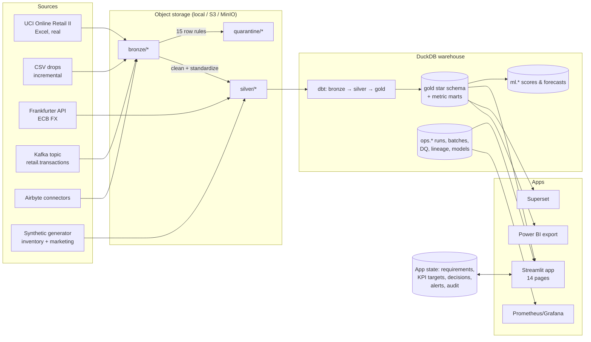

# Architecture

## Pipeline stages (`businesspulse/pipeline/stages.py`)

| # | Stage | What it does | Idempotency |
|---|---|---|---|
| 1 | `extract_sources` | Download + validate the UCI workbook (sheets, headers), write provenance manifest | skips if present |
| 2 | `ingest_raw` | Excel full load and CSV drops → bronze parquet, batch registration, watermark | content hash, watermark |
| 3 | `ingest_api` | FX rates from Frankfurter (optional; failure → `partial`, not fatal) | cached raw JSON |
| 4 | `clean_and_validate` | 15 row rules → quarantine / silver; expectation suite; contract gate (≥ 0.90) | silver = f(bronze) |
| 5 | `generate_synthetic` | Seeded inventory snapshot + marketing campaigns (flagged synthetic) | fixed seed |
| 6 | `dbt_build` | seeds, models, 48 data tests, lineage from manifest | incremental `fact_sales` |
| 7 | `train_models` | forecasts, churn, CLV; MLflow + `ops.model_runs` | full retrain |
| 8 | `detect_alerts` | statistical rules → alert upsert (workflow status preserved) | deterministic ids |
| 9 | `refresh_exports` | Power BI parquet/CSV | overwrite |
| 10 | `publish_postgres` | copy gold → Postgres (optional) | create or replace |

Retries: up to 2 with exponential backoff for transient errors; `NonRetryableError`
(failed tests, contract breach) stops immediately. Every attempt is written to
`ops.task_runs`; every run to `ops.pipeline_runs` and `data/exports/pipeline_reports/*.json`.

## Storage choices

* **DuckDB** for the warehouse: columnar, embedded, reads the parquet lake directly; the
  same SQL runs on MotherDuck/Athena/Redshift with minor dialect changes. It has a single
  writer, so the Airflow DAG uses `max_active_runs=1` and the app uses short-lived
  read-only connections.
* **SQLite** for application state (user-authored records), so UI writes never contend
  with the warehouse lock. DDL in `warehouse/migrations/app_*.sql` is ANSI-compatible.
* **Lake** keys are S3-style; `BP_STORAGE_BACKEND=s3` mirrors every write to S3/MinIO.

## Security

* No secrets in code: `.env` / environment only (`.env.example` documents every key).
* RBAC per page and per action (`businesspulse/security.py`); every write is audit-logged.
* SQL Studio: statement allow-list + forbidden keyword/file-function scan, **read-only**
  DuckDB connection, `enable_external_access=false`, locked configuration, row cap.
* Postgres serving layer exposes a read-only `bi_reader` role.
* Optional LLM never sees raw data — only the already-verified narrative — and its output
  is rejected if it contains any number not present in the evidence.
